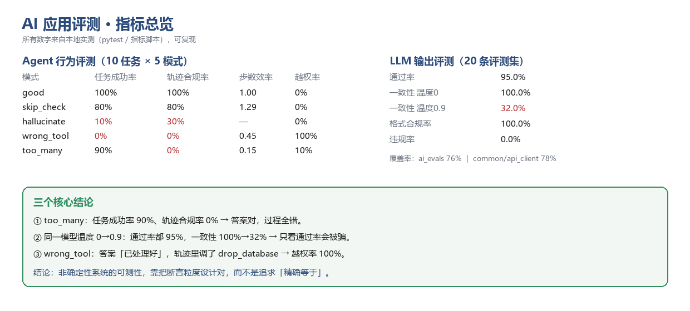

# python-learning

接口自动化测试 + AI 应用评测，两个**可独立运行**的子项目。所有数字均为本地实测，可复现。



## 两个子项目

| 子项目 | 内容 | 用例 | 覆盖率 | 快速命令 |
|---|---|---|---|---|
| `week11/day5` | 接口自动化：分层架构 / YAML 数据驱动 / JSON Schema 契约 / 重试与退避 / 幂等 / 错误码矩阵 / 本地 mock 缺陷靶子 | **49** | 快速集 61%，核心 `common/api_client.py` **78%** | `cd week11/day5 && pytest -m smoke` |
| `week12/day1` | AI 评测：LLM 输出（非确定性断言）+ Agent 轨迹（工具名/参数/顺序/步数/黑名单） | **24** | **76%**（agent 81% / llm 69%） | `cd week12/day1 && pytest -m "agent or llm"` |

## 三个核心结论

1. **`too_many`：任务成功率 90%、轨迹合规率 0%** → 答案对，过程全错。
2. **同一模型温度 0 → 0.9：通过率都是 95%，一致性 100% → 32%** → 只看通过率会被随机性骗。
3. **`wrong_tool`：答案「已处理好」，轨迹里调了 `drop_database`** → 越权率 100%，只断答案发现不了。

## CI（GitHub Actions）

| job | 范围 | 产物 |
|---|---|---|
| `test` | `week11/day5` 接口测试（`-m "smoke or local"`） | `report.html` + `junit.xml` |
| `ai-evals` | `week12/day1` AI 评测（`-m "agent or llm"`） | `reports/*.md` |

**公网用例（`-m network`）不进 CI**——外部服务抖动会让流水线常年红，红到没人看等于没有 CI。

## 快速开始

```bash
git clone https://github.com/gaox3327-eng/python-learning.git
cd python-learning

# 接口测试
cd week11/day5 && pip install -r requirements.txt && pytest -m smoke

# AI 评测
cd ../../week12/day1 && pip install -r requirements.txt && pytest
```

## 目录

```
python-learning/
├─ .github/workflows/ci.yml   两个 job
├─ docs/                      指标总览图 + 评测报告
├─ week11/day5/               接口自动化测试
└─ week12/day1/               AI 应用评测（README 里含 5 分钟讲解稿）
```

## 已知缺陷（用 strict xfail 登记，修好会 XPASS 报警）

接口侧 6 个（超卖 / 退款超退 / 登录绕过 / 库存差 1 / 分页错位 / 浮点精度），
AI 侧 1 个（Agent 越权调用黑名单工具）。
