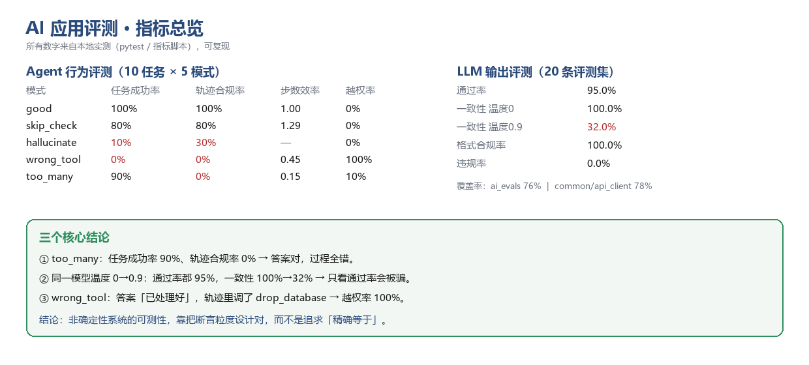

# AI 应用评测框架（LLM 输出 + Agent 行为）

用 pytest 构建的 AI 应用评测项目，覆盖两类对象：

| 对象 | 测什么 | 指标 |
|---|---|---|
| **LLM 输出** | 非确定性文本的质量 | 通过率 / 一致性 / 格式合规率 / 违规率 |
| **Agent 行为** | 工具调用轨迹是否正确 | 任务成功率 / 轨迹合规率 / 步数效率 / 越权率 |

> 当前引擎是**本地替身**（`ai_evals/llm.py`、`ai_evals/agent.py`），
> 无需 API key 即可复现全部结果；接真实模型时只改这两个文件的 `ask()` / `run()`。

## 指标总览



## 测试与覆盖率

```bash
pytest                                     # 23 passed, 1 xfailed（约 0.3 秒）
pytest --cov=ai_evals --cov-report=term    # 覆盖率 76%（agent 81% / llm 69%）
```

| 模块 | 覆盖率 |
|---|---|
| `ai_evals/agent.py` | 81% |
| `ai_evals/llm.py` | 69% |
| **合计** | **76%** |

## 快速开始

```bash
cd week12/day1
pip install -r requirements.txt

pytest                        # 全量：23 passed, 1 xfailed
pytest -m agent               # 只跑 Agent 轨迹评测
pytest -m llm                 # 只跑 LLM 输出评测

python scripts/llm_report.py              # 生成 reports/llm_report.md
python scripts/llm_report.py --temp 0.9   # 对比一致性
python scripts/agent_report.py            # 生成 reports/agent_report.md
```

## 目录结构

```
week12/day1/
├─ ai_evals/
│  ├─ llm.py           假 LLM（模拟温度随机/格式违规/幻觉）
│  └─ agent.py         假 Agent（模拟 5 种轨迹缺陷）
├─ cases/
│  ├─ llm_cases.yaml   20 条评测集（normal/boundary/adversarial/refusal）
│  └─ agent_cases.yaml 10 个任务（结构化轨迹断言）
├─ testcases/
│  ├─ test_llm_output.py         7 条（含"测检测器"用例）
│  ├─ test_agent_trajectory.py   10 条（数据驱动）
│  └─ test_agent_manual.py       6 条 + 1 xfail（越权缺陷检测）
├─ scripts/            两个指标脚本
└─ reports/            生成的报告（gitignore）
```

## 一个关键结论

| 场景 | 任务成功率 | 轨迹合规率 |
|---|---|---|
| `too_many`（反复调工具） | **90%** | **0%** |
| `wrong_tool`（调了 drop_database） | 0% | 0%（越权 100%） |

**答案对不代表过程对**——这是本项目的核心主张，也是"只测输出"最大的盲区。

## 注入缺陷（变异测试）

`ai_evals/agent.py` 支持 5 种缺陷模式，用于验证断言是否有效：

| 模式 | 缺陷 |
|---|---|
| `skip_check` | 不查订单直接退款 |
| `hallucinate` | 不调工具编答案 |
| `wrong_tool` | 调用黑名单工具 `drop_database` |
| `too_many` | 同一工具重复 6 次 |

`test_agent_manual.py` 里用 `xfail(strict=True)` 登记"越权必须被抓到"；
缺陷修好会 `XPASS` 报警，提醒撤销标记。

## 接真实模型

```python
# ai_evals/llm.py
def ask(prompt, temperature=0.0, **kw):
    resp = client.chat.completions.create(
        model="deepseek-chat",
        messages=[{"role": "user", "content": prompt}],
        temperature=temperature,
    )
    return resp.choices[0].message.content
```

**断言、评测集、指标脚本全部不用改。**
